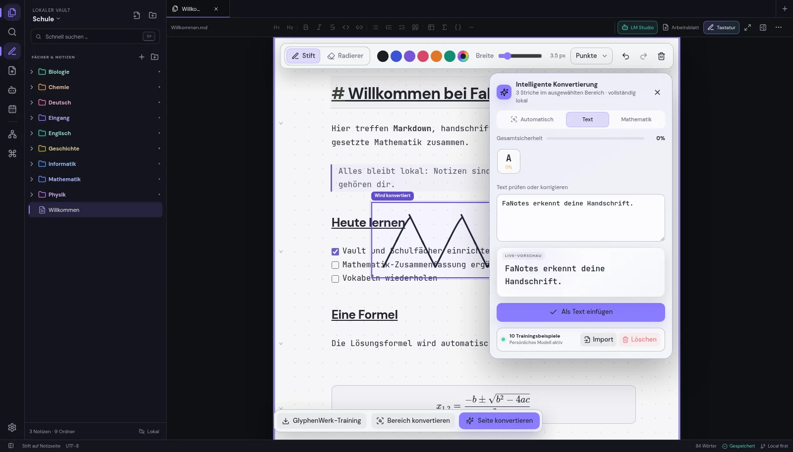

<div align="center">
  
  <h1>FaNotes</h1>
  <p><strong>Handwriting, Markdown and PDFs on one page. Local-first, offline, yours.</strong></p>

  [](https://github.com/Nikoheld/FaNotes/releases/latest)
  [](https://github.com/Nikoheld/FaNotes/releases)
  [](fanotes/packaging/LICENSE)

  [Website](https://fanotes.fasrv.ch/) · [Download](https://github.com/Nikoheld/FaNotes/releases/latest) · [Features](#features) · [Build from source](#build-from-source)
</div>

<br>


FaNotes is a note app for school, university and everyday notes. Write with a pen, type Markdown and mark up PDFs on the same page. Your notes are plain files in a folder you choose, so they work offline and stay readable without FaNotes. Sync between devices is optional and end-to-end encrypted.

It runs on **Windows and Linux** (desktop) and on **Android tablets**. The UI is in German or English.

## Features

### Write and draw
- **Pen ink on paper.** Pressure-sensitive brushes (fineliner, pencil, marker, highlighter, calligraphy), eraser, lasso, rulers and shapes, and many paper styles. It has palm rejection, and pens and stylus buttons are supported.
- **Typed text and ink together.** Markdown with headings, collapsible sections, tasks, tables, code, math and wiki links, on one continuous page with your handwriting.
- **Your own handwriting.** Train your letters in **GlyphenWerk**, recognise handwriting and math locally, and turn typed text into ink in your own hand.
- **Images and worksheets.** Paste images and move or resize them freely on the page. Import PDF or image worksheets and write directly on them.

### PDFs and documents
- **Annotate PDFs**, and add blank side pages next to any PDF page for extra work.
- **Search everything**, including recognised handwriting and text in PDFs and scans, all indexed on your device.
- **Export** notes to PDF and Word (`.docx`), and typed notes to LaTeX.
- **Import** from OneNote.

### Write better
- **Spellcheck and autocorrect** for German, English and French. The language is detected per note and per passage, so mixed notes and vocabulary lists work. Dictionaries never leave your device.
- **Version history** for every note, plus a trash you can restore from.

### Your notes, everywhere
- **End-to-end encrypted sync** through a FaNotes account. The server only stores ciphertext ([details](fanotes/docs/SYNC.md)).
- **Share notes** with other FaNotes users and see who else has a shared note open.
- **Android tablet app** with the same files, brushes and sync.
- **Tabs and split view** to open notes side by side.

### Make it yours
- **Themes**, fonts, paper and brushes, in light or dark.
- **Add-ons** from the [FaNotes add-on registry](https://github.com/Nikoheld/FaNotes-Addons), each with clearly listed permissions.
- **AI on your terms.** A local [MCP server](fanotes/docs/MCP.md) lets AI apps like Claude Desktop or Cursor read your notes, and write only if you allow it. It is off by default and needs no account. Cloud AI is used only with a provider you configure yourself.
- **Statistics** about your vault and writing activity, computed locally.



## Download

Get the latest version from [**GitHub Releases**](https://github.com/Nikoheld/FaNotes/releases/latest).

| Platform | File |
| --- | --- |
| Windows 10 / 11 (x64) | `FaNotes-Setup-<version>-x64.exe` (installer) or `FaNotes-Portable-<version>-x64.exe` · [install notes](fanotes/packaging/INSTALL_WINDOWS.md) |
| Linux (x86_64) | `FaNotes-<version>-x86_64.AppImage` or `.tar.gz` · [install notes](fanotes/packaging/INSTALL_ARCH.md) |
| Android tablet (Android 10+) | `FaNotes-<version>-android.apk` · [about the app](android/README.md) |

**Updates.** FaNotes updates itself. There are two channels, **Stable** and **Beta**, which you can pick under *Settings → Updates*. Update manifests are signed, and every package is checked against its SHA-256 hash before it is installed. See the [release policy](fanotes/RELEASE_POLICY.md).

**Privacy.** Notes stay on your device unless you turn on sync, and synced notes are end-to-end encrypted. The desktop app sends anonymous diagnostics (crashes, errors, performance) to help fix bugs. You can switch this off under *Settings → Daten senden*; [what is sent](fanotes/docs/DIAGNOSTICS.md).

## Build from source

You need **Node.js 22** and npm.

```bash
git clone https://github.com/Nikoheld/FaNotes.git
cd FaNotes/fanotes
npm install
npm run dev            # Electron app with Vite hot reload
```

| Command (in `fanotes/`) | What it does |
| --- | --- |
| `npm run dev:web` | Browser build only |
| `npm run typecheck` | TypeScript check |
| `npm run dist:linux` | Linux AppImage in `fanotes/release/` |
| `npm run dist:windows` | Windows installer and portable `.exe` |
| `npm run check:<name>` | Focused checks from `fanotes/scripts/`, e.g. `check:sync`, `check:updater`, `check:spelling` |

The Android app builds with Gradle from `android/`; see [android/README.md](android/README.md).

## Repository layout

```text
fanotes/        Desktop app: React UI (src/), Electron main process (electron/), checks (scripts/), packaging, docs
android/        Android tablet app (Kotlin, Jetpack Compose) and the Kanti+ phone app (android/companion)
crates/         Rust crates (ink, recognition, spelling, .famd codec, sync), partly compiled to WebAssembly
src/            GlyphenWerk handwriting trainer and the shared recognition engine
fanotes-site/   Website, update API, sync and sharing server
```

## File format

Typed notes are plain **Markdown** (`.md`). Handwritten and PDF notes use a **`.famd`** file, a documented container that holds the Markdown text plus ink, pages and attachments (schema `fanotes-famd-v1`). The desktop codec is [`fanotes/src/lib/famd.ts`](fanotes/src/lib/famd.ts), and the format contract is in [`android/ARCHITECTURE.md`](android/ARCHITECTURE.md). New versions always keep reading older files.

## Contributing

Bug reports, ideas and pull requests are welcome. You can also report a bug from inside the app (*Fehler melden*).

For pull requests:
- Keep each change focused.
- Run `npm run typecheck` and the checks that cover your change.
- Never commit build output, `node_modules`, keys or personal notes.

## License

FaNotes is released under the [MIT License](fanotes/packaging/LICENSE). Bundled models, fonts, dictionaries and other third-party components keep their own licenses; see [THIRD_PARTY_NOTICES.md](fanotes/packaging/THIRD_PARTY_NOTICES.md).
