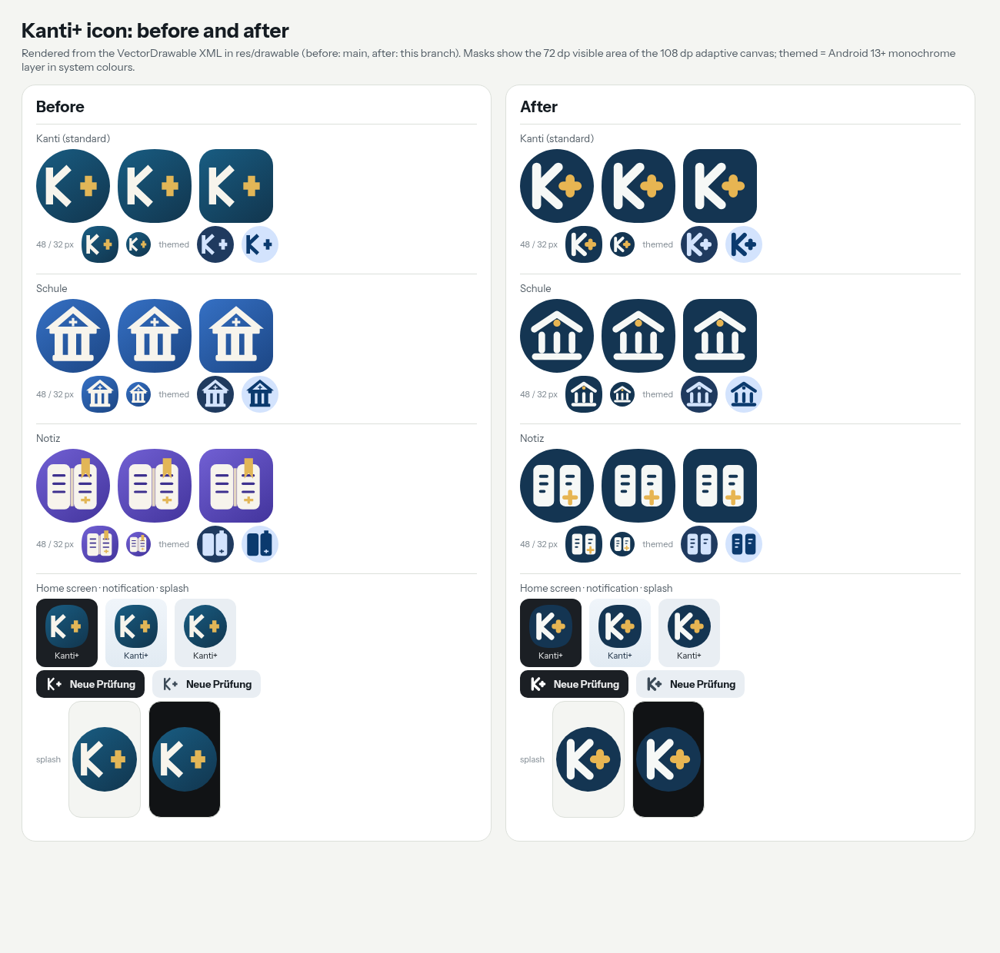

# Kanti+ mark

The Kanti+ launcher icon, its two alternatives (Schule, Notiz), the themed (monochrome) icons and
the notification icon all come from one vector source, [`gen.py`](gen.py). It writes the
VectorDrawables in `android/companion/src/main/res/drawable/` and the SVG masters in this folder.
Edit the generator, not the generated files:

```sh
python3 android/companion/docs/brand/gen.py .
```

## The mark: K+

The **K+** of the earlier icon is the core: a straight stem, two arms that meet at the stem, and a
separate gold **+**. It is drawn with the polish of the design system ([DESIGN_SYSTEM.md](../DESIGN_SYSTEM.md)):
one stroke weight for the K and the plus, round terminals, the plus nested in the K's opening and
the pair centred optically, on the flat ink tile of the light and Snow themes with paper and gold.
It reads at 32 px, in one colour and as a notification icon.

| Token | Value | Use |
| --- | --- | --- |
| Ink | `#143552` | tile (adaptive background) |
| Paper | `#F6F8F6` | K, building, pages |
| Gold | `#E7B552` | plus, school window |

- **Adaptive icon:** 108 dp canvas with the mark scaled to 0.92, inside the 66 dp safe zone, so
  circle, squircle and rounded masks all keep the whole mark.
- **Themed icon (Android 13+):** the same shapes in one colour. The Notiz pages have their lines
  cut out (even-odd), so they survive without a second colour.
- **Notification:** `ic_stat` is the white K+ silhouette, cropped to fill the 24 dp status-bar icon.
- **Splash (Android 12+):** the system splash uses the adaptive launcher icon; no theme change.
- **Wordmark:** the app shows no logo or wordmark in its UI, so none was added.

## How it got here

First round, three directions ([directions.png](directions.png)); A was chosen and shipped in the
first version of this branch:

- **A · Taktschiene:** a K whose arms branch from a round node, with a gold plus.
- **B · Tagesband:** a plus made of day-band segments. Distinctive, but it loses "Kanti" and reads
  as a generic plus.
- **C · Kachel:** a K cut out of a timetable tile with a plus badge. Busy at small sizes, and the
  badge breaks in the one-colour themed icon and in the notification icon.

Second round (feedback: keep the old K+, execute it better), see
[k-plus-variants.png](k-plus-variants.png): the old mark, the node K, and three K+ executions.
**M1 · K+ rounded** was chosen: it is the old K+ exactly as a concept, with one weight, round
terminals and the plus sized and nested to balance the K; the cut (M2) and square-cap (M3)
versions looked blunt or heavy.

[`directions.py`](directions.py) and [`k_plus_variants.py`](k_plus_variants.py) draw the rounds; [`preview.py`](preview.py) renders
before/after straight from the VectorDrawable XML and [`export.py`](export.py) writes the PNG
exports (Chromium headless).

## Exports

- `android/docs/launcher-icon/`: 512 px PNGs of each icon (square, round, squircle, one-colour on
  dark, light and themed backgrounds), the previous icons as `old-*`, and `comparison.png`.
- `play/kanti-play-icon-512.png`: Google Play store icon, 512 x 512, 32-bit PNG, full-bleed and
  fully opaque (Play applies its own mask and shadow).
- `play/kanti-feature-1024x500.png`: Google Play feature graphic, 1024 x 500, 24-bit PNG without
  alpha, key content inside the centre.


