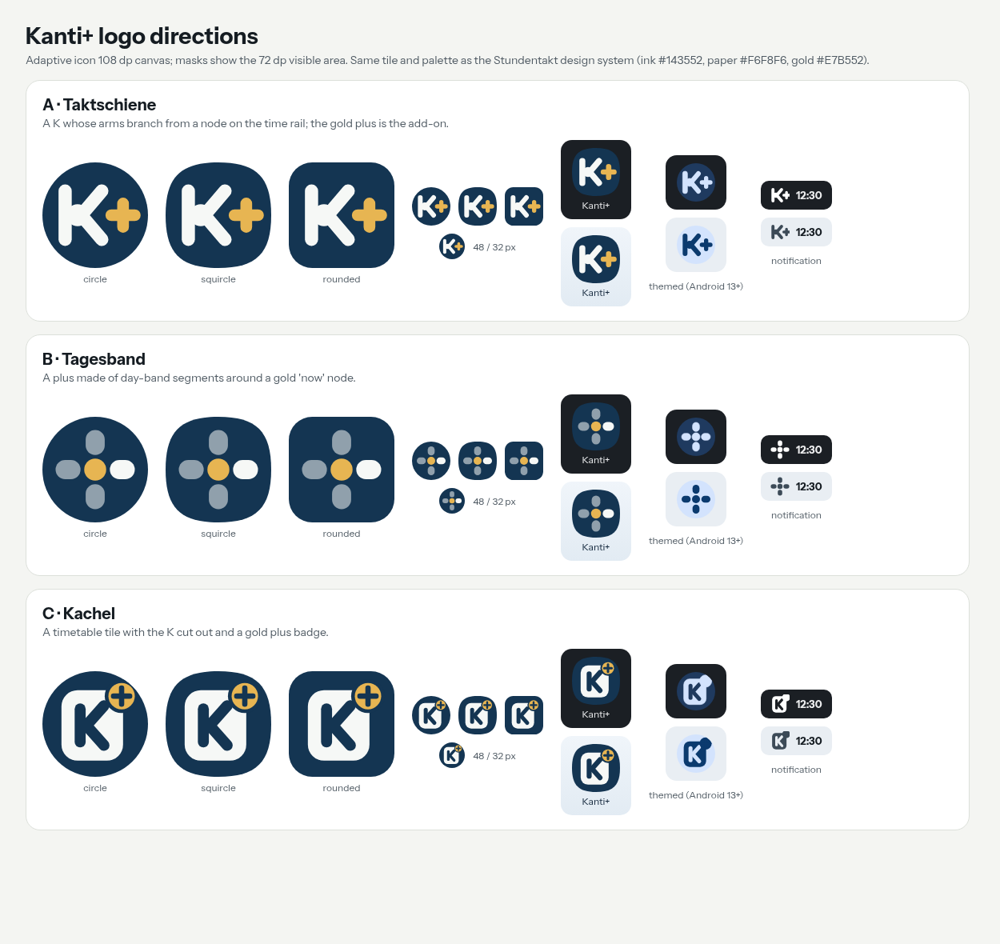

# Kanti+ mark

The Kanti+ launcher icon, its two alternatives (Schule, Notiz), the themed (monochrome) icons and
the notification icon all come from one vector source, [`gen.py`](gen.py). It writes the
VectorDrawables in `android/companion/src/main/res/drawable/` and the SVG masters in this folder.
Edit the generator, not the generated files:

```sh
python3 android/companion/docs/brand/gen.py .
```

## The mark: "Taktschiene"

A **K** whose arms branch from a round node on a vertical stem, with a gold **+** beside it. It
follows the design system ([DESIGN_SYSTEM.md](../DESIGN_SYSTEM.md)): the stem and node are the
planner's time rail and lesson node, the tile is the ink of the Snow and light themes, and gold is
the single warm accent. The shapes are bold and round-capped, so "K+" still reads at 32 px.

| Token | Value | Use |
| --- | --- | --- |
| Ink | `#143552` | tile (adaptive background) |
| Paper | `#F6F8F6` | K, building, pages |
| Gold | `#E7B552` | plus, school window |

- **Adaptive icon:** 108 dp canvas with the mark scaled to 0.92, inside the 66 dp safe zone, so
  circle, squircle and rounded masks all keep the whole mark.
- **Themed icon (Android 13+):** the same shapes in one colour. The Notiz pages have their lines
  cut out (even-odd), so they survive without a second colour.
- **Notification:** `ic_stat` is the white K+ silhouette, cropped to fill the 24 dp status-bar icon.
- **Splash (Android 12+):** the system splash uses the adaptive launcher icon; no theme change.
- **Wordmark:** the app shows no logo or wordmark in its UI, so none was added.

## Directions considered



- **A · Taktschiene** (chosen): the clearest at 48 and 32 px and as a one-colour icon, recognisably
  "K+" and continuous with the previous mark.
- **B · Tagesband:** a plus made of day-band segments. Distinctive, but it loses "Kanti" and reads
  as a generic plus.
- **C · Kachel:** a K cut out of a timetable tile with a plus badge. Busy at small sizes, and the
  badge breaks in the one-colour themed icon and in the notification icon.

[`directions.py`](directions.py) draws the three directions; [`preview.py`](preview.py) renders
before/after straight from the VectorDrawable XML (with Chromium headless).


